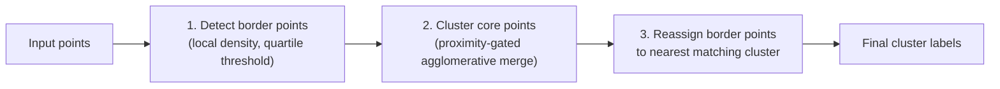
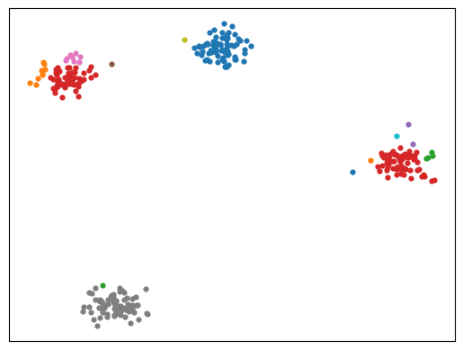

# Gauging-β

**Border-aware hierarchical clustering based on density and proximity**

[](https://www.python.org/)
[](LICENSE)
[-orange)](#citation)

Most clustering algorithms force you to pick a trade-off: tune a parameter (like *k* or ε), assume convex/blob-shaped clusters, or accept that overlapping clusters will get merged into a mess. **Gauging-β** targets all three problems at once — it detects the number of clusters automatically, handles non-convex shapes, and stays robust when clusters are poorly separated — by treating low-density border points specially instead of forcing every point through the same merge rule.

## How it works

Gauging-β runs in three stages:



1. **Border detection** (`local_density_calculation.py`) — estimates each point's local density at an automatically calibrated radius, then flags points in the bottom density quartile-ish range as *border points* so they don't drag unrelated clusters together.
2. **Core clustering** (`gauging_proximity.py::Perception`) — the remaining core points are merged bottom-up (every point starts as its own cluster). Each candidate merge is only accepted if it passes an **adaptive proximity threshold**, self-calibrated from each cluster's own merge-distance history, its neighboring clusters, and shape similarity — no fixed distance cutoff, no predefined *k*.
3. **Border reassignment** — every border point is folded back into its nearest compatible cluster (still gated by the same adaptive check), so genuinely isolated points can remain unmerged as noise.

## Key features

- Automatic cluster count — no need to specify *k* upfront
- Handles non-convex shapes and clusters of varying density
- Explicit border-point identification and reassignment
- Self-calibrating adaptive proximity threshold (no fixed distance cutoff)
- Euclidean or precomputed distance matrices
- Single- or average-linkage merge rules

## Installation

Requires Python 3.9+.

```bash
git clone https://github.com/design-zeng/Gauging-beta.git
cd Gauging-beta
pip install -r requirements.txt
```

## Quick start

```python
from sklearn.datasets import make_blobs
from gauging_proximity import Perception
from clt_tools import draw_clusters

# Any (n_samples, n_features) array works — here we generate synthetic data
X, _ = make_blobs(n_samples=300, centers=4, cluster_std=0.6, random_state=42)

model = Perception(metric='euclidean', linkage='single', log_path='plots')
labels, points = model.fit(X)

fig = draw_clusters(points, labels)
fig.savefig('plots/quickstart.png', bbox_inches='tight')
```

This is real output from the snippet above — the four dense blobs are recovered as core clusters, while sparser points at their edges surface as separate border clusters rather than being silently absorbed:



## API

### `Perception(log_path=None, metric='euclidean', linkage='single')`

| Parameter | Default | Description |
|---|---|---|
| `log_path` | `None` (falls back to `'plots'`) | Directory where diagnostic plots from `.plot()` are saved. |
| `metric` | `'euclidean'` | `'euclidean'` computes distances from raw coordinates; `'precomputed'` expects a distance matrix passed to `fit`. |
| `linkage` | `'single'` | `'single'` uses nearest-point distance between clusters; `'average'` uses mean pairwise distance. |

### `model.fit(X, distance_matrix=None)`

Runs the full three-stage pipeline. Returns `(labels, X)` — an integer label per input point, and the (unchanged) input array.

### `model.plot(withline=False)`

Saves a diagnostic figure of the current cluster state (positions, merge-distance history, density history) to `log_path`. Useful for inspecting how the adaptive threshold behaved during a run.

## Supported data formats

`clt_tools.load_data(filename, dataname)` dispatches on file extension:

| Extension | Format |
|---|---|
| `.txt` | Comma-separated values, one point per line; last column treated as a ground-truth label. |
| `.arff` | UCI-style ARFF files (header is auto-normalized, delimiters auto-converted). |
| `.h5` | HDF5 with `train`/`test` groups, each containing `data`/`target` datasets. |
| `.png` | Image pixels clustered by RGB + position. |

The repository doesn't ship sample datasets — bring your own file in one of the layouts above, or use synthetic data as in the Quick Start.

## Benchmark results

From the accompanying paper, mean NMI / ARI over 15 synthetic 2D/3D benchmark datasets (6 well-separated, 9 poorly-separated), compared against 8 baseline algorithms (K-Means++, Single Linkage, HDBSCAN, Border Peeling, CDC, RCC, Torque Clustering, and Gauging-β's own predecessor Gauging-δ):

| Method | Mean NMI | Mean ARI |
|---|---|---|
| **Gauging-β (this repo)** | **0.834** | **0.872** |
| Torque Clustering (runner-up) | 0.803 | 0.742 |
| Gauging-δ (predecessor) | 0.757 | 0.684 |

Gauging-β posts the highest mean NMI/ARI of all 9 methods on this benchmark. It also ranks **2nd of 8** on a broader 105-dataset synthetic sweep (behind HDBSCAN), achieves the **highest mean NMI (0.58)** across 7 real-world UCI datasets, and takes **first place on MNIST** (NMI 0.581) among all compared methods using ResNet-18 features. See the paper for full per-dataset tables and the ablation study isolating the contribution of border detection and reassignment.

## Scalability

Time complexity ranges from **O(n²) to O(n³)** depending on merge behavior, dominated by the core clustering stage; space complexity is **O(n²)** due to the pairwise distance matrix. This makes Gauging-β best suited to small-to-medium datasets; the paper notes a locally adaptive border-finding mechanism as future work to improve scalability.

## Citation

Jinli Yao and Yong Zeng, "Gauging-β: Border-aware hierarchical clustering based on density and proximity". *Pattern Recognition*, vol. 171, Part A, pp. 112128, March 2026.

If you use this code or algorithm, please cite:

```bibtex
@article{yao2026gaugingbeta,
  author  = {Yao, Jinli and Zeng, Yong},
  title   = {Gauging-$\beta$: Border-aware hierarchical clustering based on density and proximity},
  journal = {Pattern Recognition},
  volume  = {171},
  number  = {Part A},
  pages   = {112128},
  month   = {3},
  year    = {2026}
}
```

## Contributing

Issues and pull requests are welcome — whether it's a bug report, a new dataset loader, or a performance improvement. Fork the repo, make your changes, and open a PR.

## License

Released under the [MIT License](LICENSE).
